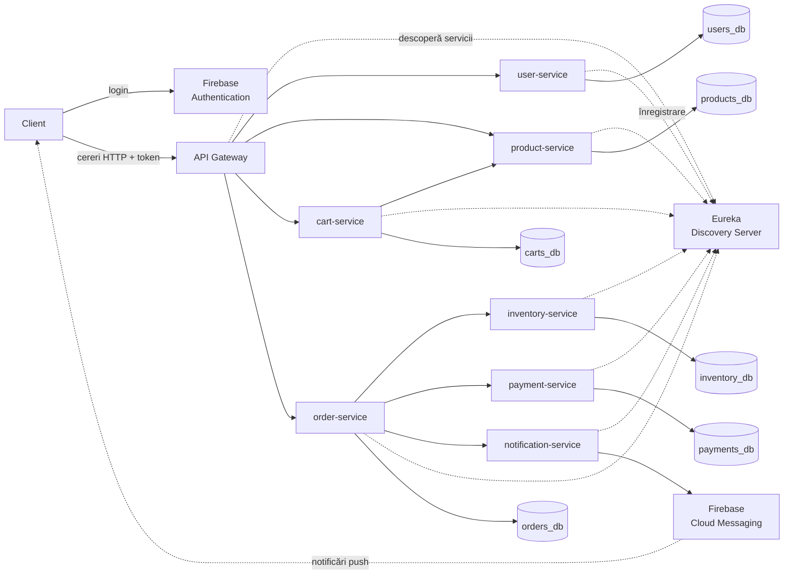

# Platformă E-Commerce bazată pe microservicii

## 1. Despre Proiect (Prezentare generală)

Aplicația noastră este un marketplace unde vânzătorii independenți își pot lista produsele, iar clienții le pot descoperi și cumpăra într-un mod sigur și rapid.

- **Cumpărătorii:** Navighează prin categorii, caută și compară produse, le adaugă în coș, finalizează comanda printr-un checkout sigur și își pot accesa istoricul comenzilor sau urmări stadiul livrării.
- **Vânzătorii:** Adaugă sau șterg produse, își actualizează prețurile și stocurile, și își urmăresc încasările.
- **Administratorii:** Au rolul de a modera platforma.

O parte critică a sistemului este felul în care gestionăm stocul la checkout: am gândit platforma astfel încât să nu permită supra-vânzarea. Dacă a mai rămas un singur produs în stoc și doi clienți dau comandă simultan, sistemul se asigură că o singură comandă va fi procesată cu succes.

### Rolurile Microserviciilor

| Microserviciu | Funcționalitate |
|---------------|------------------|
| `discovery-server` | Funcționează ca un registru (Server Eureka) unde se anunță toate serviciile noastre. |
| `api-gateway` | Punctul unic de intrare pentru client; aici verificăm autentificarea (token-ul Firebase) și rutăm cererile mai departe. |
| `user-service` | Ține profilurile și rolurile (client / vânzător / admin). Autentificarea propriu-zisă e delegată către Firebase. |
| `product-service` | Tot ce ține de catalog: produse, categorii, căutare. |
| `inventory-service` | Gestionează stocurile și se ocupă de blocarea/rezervarea strictă a cantităților la checkout. |
| `cart-service` | Gestionează coșul de cumpărături și modificarea cantităților din el. |
| `order-service` | Inima fluxului de cumpărare: plasează comenzile, gestionează statusul lor și furnizează **istoricul comenzilor** (printr-un endpoint simplu în baza sa de date). |
| `payment-service` | Procesează plățile și face verificările de bază pentru a detecta fraudele. |
| `notification-service`| Trimite alerte și confirmări utilizatorilor folosind Firebase Cloud Messaging. |

---

## 2. Diagrama arhitecturală

**Fluxul unei cereri:**
Aplicația se autentifică prin Firebase și primește un token. Toate cererile pleacă spre API Gateway împreună cu acest token. Gateway-ul îl validează, după care folosește Eureka pentru a afla adresa microserviciului de care are nevoie și direcționează cererea. Fiecare microserviciu scrie doar în propria bază de date, iar când are nevoie de informații externe, apelează celelalte servicii tot via Eureka.

**Exemplu - checkout:**
Când utilizatorul finalizează comanda, `order-service` preia inițiativa și îi cere `inventory-service`-ului să rezerve stocul necesar. Apoi, clientul este pasat către `payment-service` pentru plată. Dacă plata reușește, comanda e confirmată și `notification-service` îi trimite un mesaj push cumpărătorului prin Firebase. Dacă plata eșuează, rezervarea stocului este anulată instantaneu.

---

## 3. Tehnologiile cu care lucrăm

| Componentă | Tehnologii alese |
|------------|------------------|
| Microservicii | Java 21, Spring Boot 3, Maven |
| Service Discovery | Spring Cloud Netflix Eureka |
| API Gateway | Spring Cloud Gateway |
| Comunicare internă | REST (Spring RestClient cu Spring Cloud LoadBalancer) |
| Autentificare | Firebase Authentication (token verificat prin Firebase Admin SDK) |
| Notificări | Firebase Cloud Messaging |
| Baze de date | PostgreSQL, Spring Data JPA |
| Containerizare | Docker, Docker Compose |
| Testare | Postman |

---

## 4. Lista de neclarități 

- **Baza de date:** Folosim un singur container PostgreSQL cu mai multe baze de date logice sau câte un container per serviciu?

- **Reziliență:** Ce se întâmplă cu comunicarea dintre servicii dacă serverul Eureka nu mai este disponibil?

- **Comunicare User ID:** Cum transmitem informațiile despre utilizator (id, rol) de la Gateway către microservicii?

- **Rutare:** Configurăm rutele manual sau le generăm automat pe baza serviciilor din Eureka?
