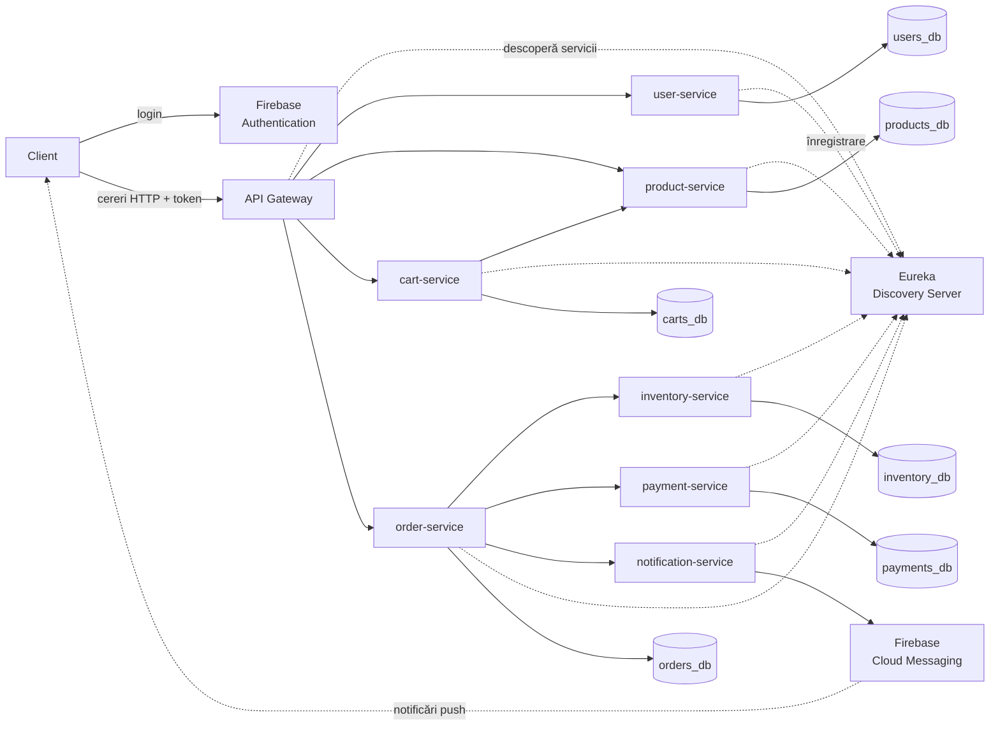

# Platformă E-Commerce bazată pe microservicii

## 1. Prezentare generală

Aplicația este o platformă e-commerce de tip marketplace, în care mai mulți vânzători independenți își listează produsele, iar cumpărătorii le pot descoperi și cumpăra în siguranță.

- **Cumpărătorii** navighează prin categorii, caută și compară produse, le adaugă în coș, finalizează comanda printr-un checkout securizat și urmăresc stadiul comenzii până la livrare.
- **Vânzătorii** creează, editează și șterg produse, actualizează prețurile și stocurile și își urmăresc vânzările și încasările.
- **Administratorii** moderează conținutul și rezolvă disputele.

Sistemul garantează consistența stocului la checkout: dacă mai există un singur produs și doi utilizatori îl cumpără simultan, doar o comandă este procesată cu succes.

### Microservicii

| Microserviciu | Responsabilități |
|---------------|------------------|
| `discovery-server` | Server Eureka: registrul în care se înregistrează toate serviciile |
| `api-gateway` | Punct unic de intrare pentru client, rutarea cererilor, verificarea token-ului Firebase |
| `user-service` | Profilurile utilizatorilor și rolurile (cumpărător / vânzător / administrator); autentificarea este realizată prin Firebase Authentication |
| `product-service` | Catalogul de produse, categorii, căutare, gestionarea produselor de către vânzători |
| `inventory-service` | Stocurile și rezervarea stocului la checkout (prevenirea supra-vânzării) |
| `cart-service` | Coșul de cumpărături și modificarea cantităților |
| `order-service` | Plasarea comenzilor, fluxul de checkout, statusul comenzii |
| `payment-service` | Procesarea plăților și verificări de bază pentru detectarea fraudelor |
| `notification-service` | Trimiterea notificărilor (confirmare comandă, schimbare status, alerte) prin Firebase Cloud Messaging |

---

## 2. Diagrama arhitecturală

**Fluxul unei cereri:** clientul Angular se autentifică prin Firebase Authentication și primește un token. Cererile sunt trimise cu acest token către API Gateway, care îl verifică și află din Eureka adresa microserviciului țintă. Microserviciul citește și scrie în propria bază de date și, dacă este nevoie, apelează alte servicii, descoperite tot prin Eureka.

**Exemplu – checkout:** `order-service` cere `inventory-service` să rezerve stocul, apoi apelează `payment-service`. Dacă plata reușește, comanda și stocul sunt confirmate și `notification-service` trimite o notificare cumpărătorului prin Firebase Cloud Messaging. Dacă plata eșuează, rezervarea stocului este anulată.

---

## 3. Tehnologii alese

| Componentă | Tehnologii |
|------------|------------|
| Microservicii | Java 21, Spring Boot 3, Maven |
| Service Discovery | Spring Cloud Netflix Eureka |
| API Gateway | Spring Cloud Gateway |
| Comunicare între servicii | REST (Spring RestClient cu Spring Cloud LoadBalancer) |
| Autentificare | Firebase Authentication (token verificat cu Firebase Admin SDK) |
| Notificări | Firebase Cloud Messaging |
| Bază de date | PostgreSQL, Spring Data JPA |
| Containerizare | Docker, Docker Compose |
| Testare | Postman |

---

## 4. Lista de neclarități

- Folosim un singur container PostgreSQL cu mai multe baze de date sau câte un container per serviciu?
- Ce se întâmplă cu comunicarea dintre servicii dacă serverul Eureka nu mai este disponibil?
- Cum transmitem informațiile despre utilizator (id, rol) de la Gateway către microservicii?
- Configurăm rutele manual sau le generăm automat pe baza serviciilor din Eureka?
