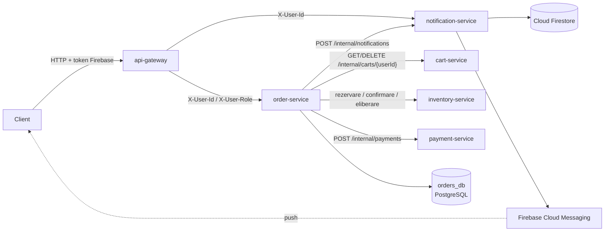
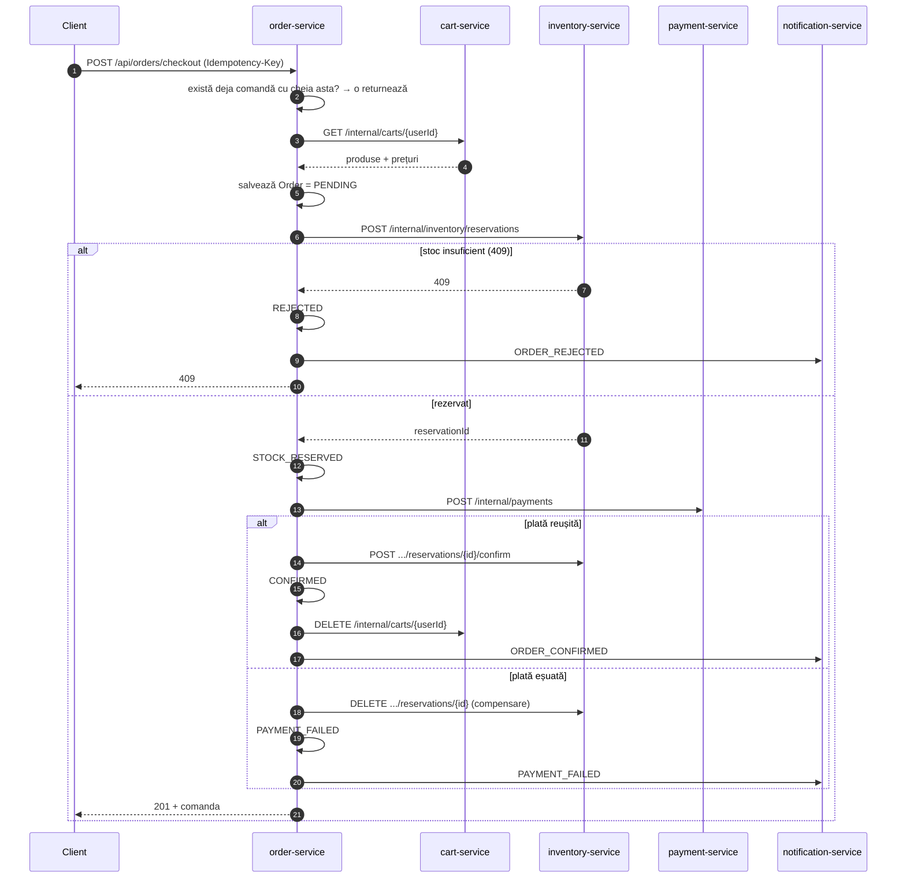
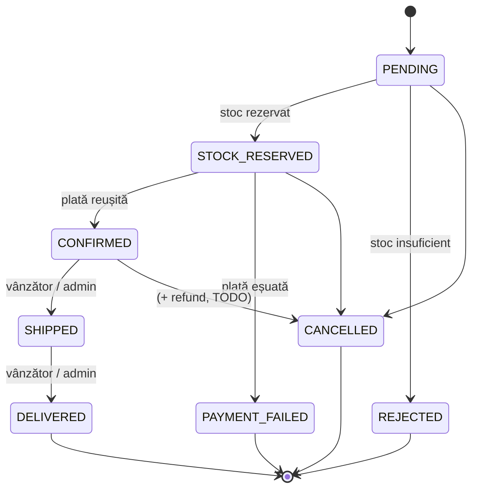
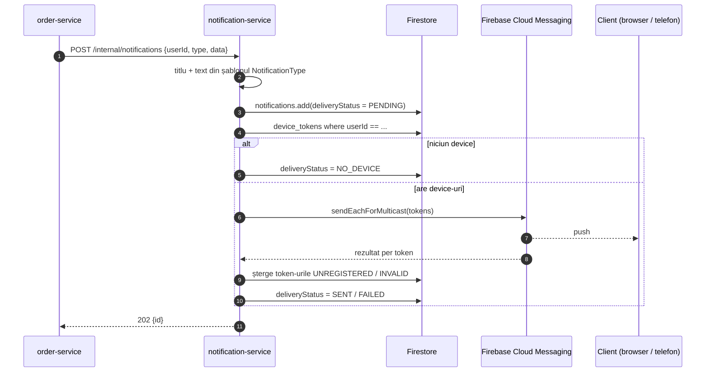

# Arhitectura: `order-service` și `notification-service`

Document de lucru pentru cele două servicii. Completează [README](../README.md); contractele marcate **(de confirmat)** trebuie stabilite cu colegii care implementează celelalte servicii.

---

## 1. Locul celor două servicii în sistem



Față de diagrama din README apar două lucruri noi:
- **`order-service → cart-service`**: produsele și prețurile comenzii se citesc din coș, nu din body-ul trimis de client (altfel prețul ar putea fi modificat din frontend).
- **`notification-service → Cloud Firestore`**: notificările și token-urile de device se stochează în Firestore, nu în PostgreSQL.

### Decizii comune (propuse pentru „Lista de neclarități” din README)

| Întrebare | Propunere |
|---|---|
| Cum ajung `userId` / rolul la servicii? | Gateway-ul validează token-ul Firebase și adaugă header-ele `X-User-Id` (Firebase UID) și `X-User-Role` (`CUSTOMER` / `SELLER` / `ADMIN`). Serviciile au încredere în ele, deci **nu trebuie expuse direct în afara rețelei Docker**. Gateway-ul trebuie să șteargă orice `X-User-*` venit de la client. |
| Endpoint-uri apelate doar între servicii | Prefix `/internal/**`, pe care gateway-ul **nu îl rutează**. |
| Erori | Răspunsuri `ProblemDetail` (RFC 7807): 404 inexistent, 409 conflict de stare / stoc, 403 fără drepturi. |

---

## 2. `order-service`

### 2.1 Structura pachetelor

```
order-service/src/main/java/com/ecommerce/orderservice/
├── OrderServiceApplication.java
├── config/RestClientConfig.java      RestClient @LoadBalanced (rezolvare prin Eureka)
├── web/
│   ├── OrderController.java          endpoint-urile publice /api/orders
│   └── UserHeaders.java              numele header-elor + roluri
├── service/OrderService.java         orchestrarea checkout-ului (saga) + reguli de acces
├── domain/
│   ├── Order.java                    entitate JPA, @Version pentru optimistic locking
│   ├── OrderItem.java                snapshot produs (nume, preț la momentul comenzii)
│   ├── OrderStatus.java              mașina de stări (canTransitionTo)
│   └── ShippingAddress.java          @Embeddable
├── repository/OrderRepository.java
├── client/                           apeluri REST către celelalte servicii
│   ├── CartClient / InventoryClient / PaymentClient / NotificationClient
│   └── dto/ClientDtos.java           contractele (de confirmat)
├── dto/                              CheckoutRequest, OrderResponse, UpdateStatusRequest
└── exception/                        excepții + GlobalExceptionHandler
```

### 2.2 Fluxul de checkout

Apelurile către alte servicii **nu** se fac într-o tranzacție DB deschisă. Fiecare pas își salvează separat starea, ca să se vadă mereu unde a rămas comanda dacă ceva pică.



**Supra-vânzarea** se previne în `inventory-service`: rezervarea trebuie să fie atomică (ex. `UPDATE stock SET reserved = reserved + :q WHERE product_id = :id AND available - reserved >= :q`, sau lock pesimist) și să răspundă **409** dacă oricare produs nu are stoc. `order-service` doar tratează acel 409.

### 2.3 Mașina de stări



Implementată în `OrderStatus.canTransitionTo`; `Order.changeStatus` aruncă `InvalidOrderStateException` (→ 409) la o tranziție nepermisă.

### 2.4 Model de date (`orders_db`)

| `orders` | | `order_items` | |
|---|---|---|---|
| `id` UUID PK | | `id` UUID PK | |
| `user_id` (Firebase UID) | index cu `created_at` | `order_id` FK | |
| `status` | | `product_id` | |
| `total_amount`, `currency` | | `seller_id` | pentru acces vânzător |
| `shipping_address` (coloane embedded) | | `product_name` | snapshot |
| `reservation_id`, `payment_id` | | `unit_price` | snapshot |
| `failure_reason` | | `quantity` | |
| `idempotency_key` UNIQUE | | | |
| `version` (optimistic lock), `created_at`, `updated_at` | | | |

### 2.5 API public (prin gateway)

| Metodă | Cale | Cine | Descriere |
|---|---|---|---|
| POST | `/api/orders/checkout` | cumpărător | Plasează comanda din coș. Header opțional `Idempotency-Key`. Body: `shippingAddress`. |
| GET | `/api/orders?page=0&size=10` | cumpărător | **Istoricul comenzilor**, cele mai noi primele. |
| GET | `/api/orders/{id}` | proprietar / vânzător implicat / admin | Detaliile comenzii. |
| POST | `/api/orders/{id}/cancel` | proprietar / admin | Anulare. |
| PATCH | `/api/orders/{id}/status` | vânzător implicat / admin | `{"status":"SHIPPED"}` sau `DELIVERED`. |

### 2.6 Contracte cu alte servicii (de confirmat)

| Serviciu | Apel | Request | Response |
|---|---|---|---|
| cart | `GET /internal/carts/{userId}` | – | `{userId, items:[{productId, sellerId, productName, unitPrice, quantity}]}` |
| cart | `DELETE /internal/carts/{userId}` | – | 204 |
| inventory | `POST /internal/inventory/reservations` | `{orderId, items:[{productId, quantity}]}` | `{reservationId}`; **409** dacă nu e stoc |
| inventory | `POST /internal/inventory/reservations/{id}/confirm` | – | 204 |
| inventory | `DELETE /internal/inventory/reservations/{id}` | – | 204 |
| payment | `POST /internal/payments` | `{orderId, userId, amount, currency}` | `{paymentId, status: SUCCEEDED/FAILED, failureReason}` |

---

## 3. `notification-service`

### 3.1 Structura pachetelor

```
notification-service/src/main/java/com/ecommerce/notificationservice/
├── NotificationServiceApplication.java
├── config/
│   ├── FirebaseProperties.java       firebase.credentials-path, firebase.project-id
│   └── FirebaseConfig.java           beans: FirebaseApp, Firestore, FirebaseMessaging
├── web/
│   ├── NotificationController.java   /internal/notifications + /api/notifications
│   └── DeviceController.java         /api/notifications/devices
├── service/
│   ├── NotificationService.java      salvare → push → curățare token-uri
│   ├── DeviceService.java            înregistrare / dezînregistrare device
│   └── PushSender.java               wrapper peste FCM sendEachForMulticast
├── repository/                       acces Firestore (mapare manuală Map <-> record)
│   ├── NotificationRepository.java
│   ├── DeviceTokenRepository.java
│   └── Futures.java                  ApiFuture → rezultat blocant
├── domain/                           Notification, DeviceToken, NotificationType (șabloane text), DeliveryStatus
├── dto/                              SendNotificationRequest, RegisterDeviceRequest
└── exception/
```

### 3.2 Fluxul unei notificări



Notificarea e salvată **înainte** de push, deci apare în istoricul din aplicație (clopoțelul) chiar dacă push-ul eșuează sau userul nu a acceptat notificările în browser.

Pentru `order-service` notificările sunt *best-effort*: dacă `notification-service` e căzut, comanda rămâne validă și doar se loghează un warning.

### 3.3 Model de date (Cloud Firestore)

```
notifications/{autoId}
    userId:          string      (Firebase UID)
    type:            string      ORDER_CONFIRMED | ORDER_REJECTED | PAYMENT_FAILED | ORDER_CANCELLED | ORDER_SHIPPED | ORDER_DELIVERED
    title:           string
    body:            string
    data:            map<string,string>   ex. { orderId, total }
    read:            bool
    deliveryStatus:  string      PENDING | SENT | NO_DEVICE | FAILED
    createdAt:       timestamp

device_tokens/{fcmToken}       ← id-ul documentului = token-ul, deci fără duplicate
    userId:          string
    platform:        string      WEB | ANDROID | IOS
    updatedAt:       timestamp
```

Interogarea „notificările mele, cele mai noi primele” are nevoie de un **index compus** (`userId ASC, createdAt DESC`). E definit în [firestore.indexes.json](../notification-service/firestore.indexes.json); se aplică cu `firebase deploy --only firestore:indexes`, sau se creează din link-ul pe care Firestore îl dă în eroare la prima rulare.

### 3.4 API

| Metodă | Cale | Cine | Descriere |
|---|---|---|---|
| POST | `/internal/notifications` | order-service | `{userId, type, data}` → 202 `{id}` |
| GET | `/api/notifications?limit=20` | user | Istoricul notificărilor. |
| PATCH | `/api/notifications/{id}/read` | user | Marchează ca citită. |
| POST | `/api/notifications/devices` | user | `{token, platform}`, apelat de frontend după login, cu token-ul obținut din `getToken()` al Firebase Messaging. |
| DELETE | `/api/notifications/devices/{token}` | user | La logout. |

### 3.5 Configurare Firebase

1. Firebase Console → *Project settings* → *Service accounts* → *Generate new private key*.
2. Salvați fișierul ca `firebase-service-account.json` **în afara git-ului** (e deja în `.gitignore`).
3. Variabile de mediu:
   - `FIREBASE_CREDENTIALS_PATH=/cale/catre/firebase-service-account.json`
   - `FIREBASE_PROJECT_ID=<id-proiect>`
4. Activați **Cloud Firestore** în proiect (mod *production*; serviciul scrie cu Admin SDK, care ignoră regulile de securitate).
5. Local, fără cont real, se poate folosi emulatorul: `firebase emulators:start --only firestore` + `FIRESTORE_EMULATOR_HOST=localhost:8080`. FCM nu are emulator, deci push-ul se testează doar cu proiectul real.

În frontend e nevoie de cheia **VAPID** (Cloud Messaging → *Web Push certificates*) și de un `firebase-messaging-sw.js` pentru push în browser. Asta e treaba echipei de frontend, dar fără token înregistrat prin `/devices` nu se trimite niciun push.

---

## 4. Ce mai e de implementat

Scheletul compilează și are fluxul principal scris. Mai rămân:

**order-service**
- [ ] Confirmat contractele din §2.6 cu colegii (căi, nume de câmpuri, coduri de status).
- [ ] Refund la anularea unei comenzi `CONFIRMED` (`PaymentClient.refund`) + repunere stoc.
- [ ] Ce se întâmplă dacă `inventory-service` e căzut la rezervare (acum comanda rămâne `PENDING`); un job care expiră comenzile `PENDING`/`STOCK_RESERVED` mai vechi de N minute și eliberează rezervarea.
- [ ] Timeout la plată ≠ plată eșuată: plata poate să fi trecut. Ar trebui verificat statusul la `payment-service` înainte de a elibera stocul.
- [ ] Endpoint pentru vânzător: comenzile care conțin produsele lui (pentru încasări).
- [ ] Flyway în loc de `ddl-auto: update`.
- [ ] Teste: `OrderService` cu mock-uri pentru clienți (happy path, stoc insuficient, plată eșuată, idempotență).
- [ ] Timeouts pe `RestClient` și, opțional, Resilience4j (circuit breaker / retry).

**notification-service**
- [ ] Retry programat (`@Scheduled`) pentru notificările `FAILED`.
- [ ] `GET /api/notifications/unread-count` pentru badge.
- [ ] (opțional) Notificări către vânzător la o comandă nouă cu produsele lui.
- [ ] (opțional) Notificare și pe email, ca rezervă când userul nu are device.
- [ ] Teste: `NotificationService` cu `PushSender` și repository-uri mock-uite.

**Comun / infrastructură**
- [ ] Rute în `api-gateway` pentru `/api/orders/**` și `/api/notifications/**`, fără `/internal/**`.
- [ ] Intrări în `docker-compose.yml` (porturi: order `8085`, notification `8088`; cheia Firebase montată ca volum).
- [ ] Colecții Postman pentru ambele servicii.

---

## 5. Rulare locală

```bash
# order-service (necesită PostgreSQL cu baza orders_db și Eureka pornit)
cd order-service && mvn spring-boot:run

# notification-service (necesită credențialele Firebase, vezi 3.5)
cd notification-service && mvn spring-boot:run
```
